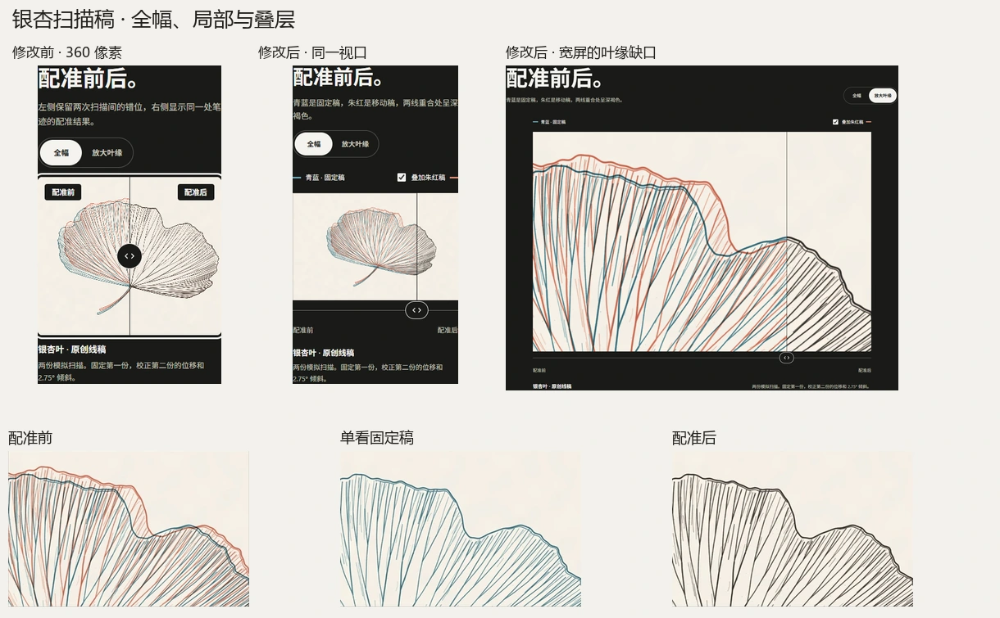

# UI Craft

`ui-craft` 是一个中文 Codex 技能，用于制作、还原和评审网页、桌面与移动界面、游戏 HUD 和静态视觉作品。它要求在实际尺寸下检查成品，并用键盘、触屏或游戏输入走完受影响的操作。技能内附 11 种网页模板、配色与截图工具，以及可运行的 HTML 和 Godot 样例。[技能说明](SKILL.md)

## 安装到 Codex

在 Codex 对话中粘贴这一行即可安装首个发布版。

```text
请用 $skill-installer 从 https://github.com/Hell-space/ui-craft 安装 v1.0.0。技能在仓库根目录（--path .），安装名为 ui-craft（--name ui-craft）。
```

手动安装时，将压缩包内的 `ui-craft` 文件夹放入 `~/.codex/skills/`。如果设置了 `CODEX_HOME`，请放入该目录下的 `skills/`。安装后，在下一条消息中用 `$ui-craft` 调用。[下载 v1.0.0 安装包](https://github.com/Hell-space/ui-craft/releases/download/v1.0.0/ui-craft-v1.0.0.zip)

## 使用示例

> 用 $ui-craft 修一下文章页。手机上读到一半时点“关注”，页面会跳回顶部。请保留现有排版，修好后从同一段落再试一次。

> 用 $ui-craft 检查这个节奏游戏。玩家在判定框边缘按键时，画面提示和得分是否一致？把同一拍的按键、判定和反馈放在一起比较。

想从模板开始，可以在技能目录运行下面的命令，生成可离线打开的扫描稿对照页。

```sh
python scripts/scaffold.py --type compare --system-fonts --single --out compare.html
```



这个样例用同一片叶子的缺口检查叠层有没有对准。附带的回归还会检查全幅四角、放大焦点，以及手机纵向滚动是否误拖分界线。[模板与命令](references/kit.md) · [前端实测记录](evals/frontend-studio.md) · [游戏样例](examples/README.md)
