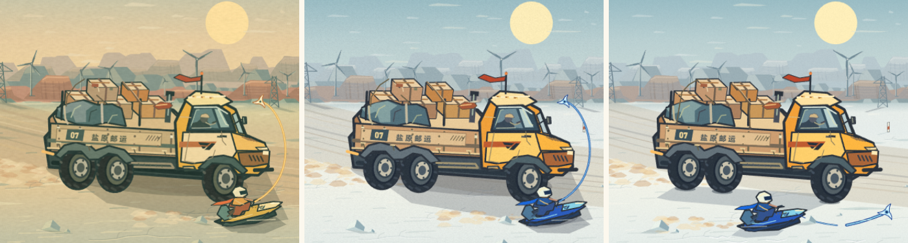

# 《白盐急递》的盐地、车轮与回旋刃

用户提供了 461 × 375 的封面局部，并要求新作摒弃墨绿色。先单独记录对原图和实际 Canvas 绘制代码的判断，再让 Claude Code 的 Opus 5.5「超高」独立阅读同一张图。它只收到图片和护送货车、小艇、回旋刃的设定。两次评稿完成后才合并意见。

| 局部 | 两次评稿与取舍 |
|---|---|
| 天空、地面和货物 | 首读测得天色约 `#DDCAA3`，盐地约 `#D5C49C`。黄漆、纸箱、尘土靠相近的黑线才能分开。Opus 还注意到左侧橙色建筑带与货箱顶边合并，右上的刀尖在亮天空里消失。校样给盐壳留出近白受光面，保留货车的邮政黄，压低货箱后方建筑的彩度。 |
| 骑手、前轮和刀迹 | 两次都把贴着前轮的头盔读成了车的一部分。只把玩家与武器改为蓝色，这一处仍粘连。最后一帧调整了两者的净空，让轨迹从出手侧越过盐地，逐段指向刀头。车顶旗杆也与后方风机错开。 |
| 单帧能判断的范围 | Opus 提醒，连续弧线既像飞行路径也像系绳。该误读能用封面纠正。敌人是否缺失、碰撞是否穿模以及刀是否正确旋转，需要相应的运行证据。本图没有完整 HUD。 |

三栏保持同一取景和显示尺寸。左栏来自用户原图。中栏使用原游戏的绘制代码，只调色。右栏维持中栏的配色方向，并调整遮挡、挂点、接触阴影和投影。两种校样都用本地 Canvas 渲染。这套冷盐白、暖车漆、蓝色回旋刃只服务于这一幕。

## 固定光源下的转向

原游戏把小艇和投影烘在同一张精灵上，转向时整体水平镜像。固定镜头、光源、缩放和锚点，只切换朝向，单独读取投影层。以透明度加权计算像素横坐标，原画法两个朝向的重心相差 **16.86 像素**。校样把投影放进世界坐标，再翻转艇身，两次只差 **0.03 像素**。此结果适用于该方向光和小艇的渲染条件。校样单独保存，已发布游戏继续使用原素材。

## 禁色与跨题复验

在独立离线的夸克浏览器里生成 11 种网页入口、9 种单独指定的风格以及一份深绿种子覆盖，共 21 组、42 次明暗渲染。逐页查看背景、面板、描边、状态与关键文字，并对先前出现墨绿的元素重新取样。

| 实际使用位置 | 旧的混色 | 修订后同处取样 |
|---|---|---|
| 设置页的三像素焦点环 | `#1F3D31` | `#313740` |
| 计时器已完成的时间段 | `#3A7267` | `#59687F` |
| 发布页的扫描线 | `#437B6E` | `#627087` |
| 渐变 98% 处，分别以实色和 CSS 变量输出 | `#305D58` / `#315C58` | `#47556A` / `#47546A` |

Element Plus、ImGui、Tailwind、ttk 和 SVG 另查导出值。ImGui 的选中底使用蓝灰，明亮的薄荷勾形仍可辨认。网页颜色来自渲染像素，框架记录来自生成文件。缩放和抗锯齿会产生新的边缘颜色，单个像素不足以认定设计使用了某种色面。

其他题材先选出需要识别的材料、对象和动作。潜行场面可以靠遮挡和运动辨认玩家，双色印刷可以靠线型区分状态。mod 图标在宿主槽位及实际缩放下检查，工具检查焦点、选择和结果是否能在明暗主题里分开。日常出稿和修稿均由当前执行者在本地完成。[场景与素材的判断方法](../references/game-asset-readability.md)

