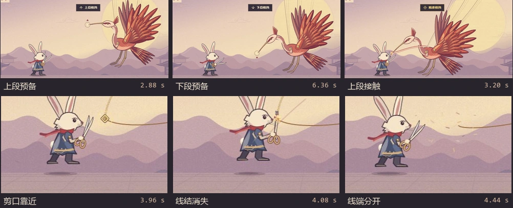
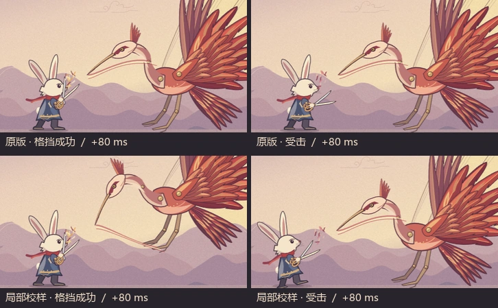

# 《断线之夜》的实机评稿

样本采用已发布版本的同一份离线源文件，提交号为 `96fcee7`。维护者先在断网的夸克中按键上挡、剪线，再故意漏接下一击。随后从桌面 1120 × 700 和触控仿真 390 × 844 的运行画面取样。独立首评写好后，Claude Code 的 Opus 5.5「超高」在新会话中看了五张原版实机画板，并从 25 fps 的桌面无声回放中抽帧。它只收到画面和游戏设定。竖屏给它的是连续截图，音效和实体设备的触感不在这次评稿的证据范围内。

| 项目 | 维护者的首读 | Opus 的独立意见 | 综合后保留的判断 |
|---|---|---|---|
| 场景 | 月轮托起红翼，幕布与层叠远景很快交代场所。进入战斗后，喙尖移到天空前，剪口在手机上却落到紫色山脊和鸟爪附近。 | 首屏的月圆与红色剪影值得保留。游戏里的台面留空较多，竖屏翼尾挤到右幕，浅金线横过浅黄月面也会失去对比。 | 按“看剧目、读来势、找线结”分别看注意力的位置。在操作点经过的真实背景上调边缘、净空或取景。能说明动作的留白，以及有意裁掉的翼尖，都可以保留。 |
| 动作 | 上下段的预备剪影读得出，但冲刺换段时，颈部弯度突然回中。白兔的剪刀能到位，双脚却沿着弧线保持同一个张开姿势。 | 它认可起跳、落地、围巾和影子连出了一段可读的动作。它更在意格挡与受击的接触画面相似，以及两种来势最后都落在白兔上半身。 | 位移弧线成立，仍可以缺少支撑与卸力。先判断是否符合纸偶的构造。若需要两种不同反应，把差别放在落点、支点或受力方。 |
| 剪线 | 刀刃和金结接上，线端分开，计数在闭刃后才变化。小尺寸下细金线及飞屑容易读作普通命中。 | 它认可剪合与回落，认为全景里的火花偏弱。初步从 0/9 到 2/9，悬线在减少，朱鹭本身的姿态变化很小。 | 先试关键线段的邻接对比、松脱后的断口，或有叙事依据的关节反应。无需靠增大所有火花来说明进度。逐根改变姿态也取决于玩法与叙事。 |

## 用同一上段攻击校正结论

Opus 最初比较的是 3.20 秒的上段成功与 6.60 秒的下段受击。两帧本身不能分清方向和结果各造成了什么差异。维护者重新从同一开局出发，在相同机位和时钟分别挡住、放过第一记上段。两次的耐久在判定当拍已分别为 4 与 3，剪刀姿态和碎屑颜色也有区别。朱鹭在两个分支却沿同一路径退回。在接触后 0、80、176 毫秒，白兔的受击后仰量仍为零。到 224 毫秒，受击版才进入明显的后仰，成功版已经出现线结。这才是“结果不够分明”的具体位置，不能由此说游戏漏了受击状态或判定有延迟。

下图上排为这次原版实测，下排是隔离副本的表现校样。四幅均取同一上段攻击接触后 80 毫秒。校样在成功格挡时让喙受到偏转，受击时让兔子立即卸力。两种条件各取五个时间点，原版与校样的判定阶段、耐久、计分和断线数相同。校样没有发布到游戏中。

两边对动作的取舍有差异。Opus 提议试短暂停顿，维护者保留了连续的游戏时钟。两边都认同落点附近要看得清。原作在剪线阶段约 0.71 秒的 30% 处同时触发线结消失、断线记分、音效调用和粒子。这个实现时点约为 213 毫秒，只能说明本作表现与事件的关系。本次没有测输出设备的声延迟。格挡窗口、其他作品的停顿时长以及真人是否更快读懂，还需各自的证据。

## 换到其他场景

- **机关解谜。** 在 Godot 的《潮汐修船坞》回放里，同一座桥降到行程 0.11 时已开始动作，行程 1.00 时桥面可承重。按住重复命令不会中途翻向，随后角色能走到对岸。该次为引擎无窗口运行，31 项状态检查通过。
- **装备 MOD。** 《砾湾工坊》用引擎手柄事件从已装备槽移到另一项。预览改变，装备基准仍在原槽。取消回到所选槽，确认才改变装备标志。换宿主皮肤与 GUI 缩放后也复验了状态与边界。这一题用槽位和焦点表达结果就足够。
- **日常工具。** 在 1000 与 360 像素宽的返修台账中，开启减弱动态，选择 R-0217 后标为已修复。勾形与文字留在这张工单上，重新开放后它从已修复筛选消失，在待修筛选重新出现。该交互可以完全静默、即时。

另外用候选技能盲测了一道新委托。执行者收到“三条音轨之间移动片段，其中一条锁定”的简报，未收到游戏评稿。维护者随后独立操作其离线成品，在 1060 和 360 像素宽、减弱动态的条件下，将“晚点播报”由同期声移到环境声，再尝试移入锁定的节拍参照。成功后焦点随片段移动，起止时间保持 0.5 至 3.5 秒。被拒时锁定轨标出原因，片段还在环境声，撤销将其送回同期声。执行者还发现，初稿移轨后按 Tab 会越过同轨右侧片段。按时间码校正焦点顺序后，维护者再次移轨，下一次 Tab 已落在同轨右侧的“进站风声”。因此技能也加上了结果之后再走一次实际输入的检验。[窄屏实际拒绝状态](evidence/timeline-locked.webp)

[通用指导与条件反例](../references/action-feedback.md)

